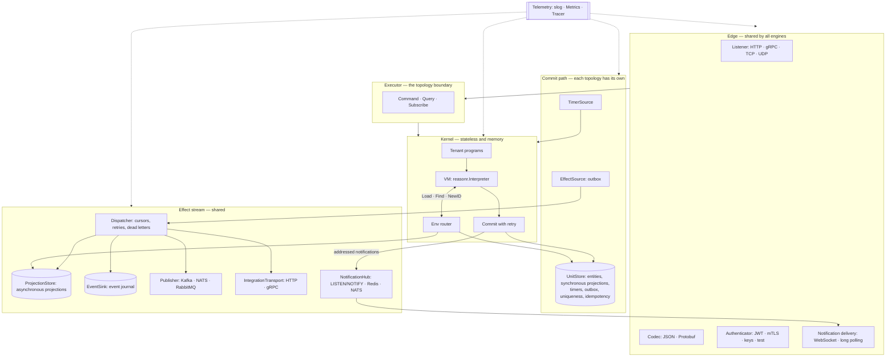
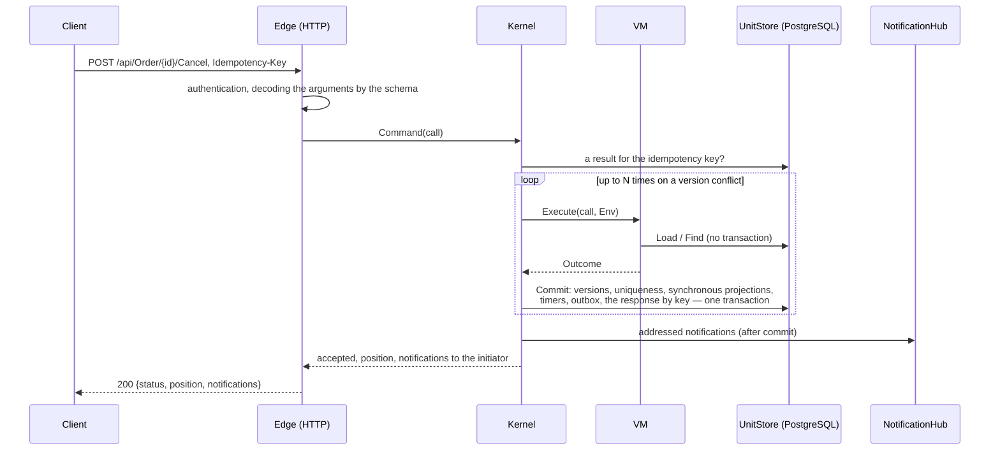

# Plan: the ReasonR stateless engine — PostgreSQL, the HTTP API and composable infrastructure

| | |
|---|---|
| **Basis** | [RFC-0001](https://github.com/tycheg/reasonr-compiler/blob/main/docs/rfc/0001-reasonr-language/README.md), stage 3 of the implementation plan (§38): "PostgreSQL engine + HTTP API"; the author's requirement — the engine is assembled from interchangeable components (stores, transports, buses, telemetry), and the abstractions are reused by other engine kinds |
| **Status** | Approved 2026-10-04 with all the decisions of [§2](#2-decisions-to-approve) (decision 10 — in the author's wording); the RFC changes ([§18](#18-what-changes-in-the-rfc)) are made at the start of the implementation. Done; progress — [0003-engine-progress.md](0003-engine-progress.md) |
| **Date** | 2026-10-04 |
| **Implementation language** | Go 1.23+ |
| **Note** | Paths, package names and RFC section numbers are those of the time (the repository `tycheg/reasonr` before the split) |

---

## Contents

1. [Goal and scope](#1-goal-and-scope)
2. [Decisions to approve](#2-decisions-to-approve)
3. [Architecture](#3-architecture)
4. [Ports](#4-ports)
5. [Composition: configuration, registry, build](#5-composition-configuration-registry-build)
6. [Repository layout](#6-repository-layout)
7. [Stage E1. Engine kernel and ports](#7-stage-e1-engine-kernel-and-ports)
8. [Stage E2. Server, HTTP API and notifications](#8-stage-e2-server-http-api-and-notifications)
9. [Stage E3. PostgreSQL](#9-stage-e3-postgresql)
10. [Stage E4. The effect stream](#10-stage-e4-the-effect-stream)
11. [Stage E5. `reasonr test --engine http` and load](#11-stage-e5-reasonr-test---engine-http-and-load)
12. [Stage E6. Second port implementations](#12-stage-e6-second-port-implementations)
13. [Other engine kinds on the same ports](#13-other-engine-kinds-on-the-same-ports)
14. [Testing](#14-testing)
15. [Schedule and milestones](#15-schedule-and-milestones)
16. [Risks](#16-risks)
17. [Acceptance criteria](#17-acceptance-criteria)
18. [What changes in the RFC](#18-what-changes-in-the-rfc)

---

## 1. Goal and scope

**Goal:** a production engine for ReasonR models — a stateless application server on top of a transactional store, assembled from components by configuration. For one project that is PostgreSQL + HTTP. For another: MongoDB, events in ClickHouse, some projections in OpenSearch, Kafka, Redis, gRPC, OpenTelemetry.

There will be three backend engines, and they share abstractions:

| Engine | Status | How it runs commands |
|---|---|---|
| **memory** | Exists (`engine/memory`) | Everything in process memory: tests, local development |
| **stateless** | This plan | Many identical processes without state; the state is in a transactional store, concurrency is optimistic versions (RFC §30.6) |
| Other kinds | Future, [§13](#13-other-engine-kinds-on-the-same-ports) | Their own executor and commit path on the same ports |

**In the plan:**

- **ports** — Go interfaces for every kind of infrastructure: the executor, stores, the effect stream, buses, transports of incoming and outgoing calls, notification delivery, authentication, telemetry; conformance test suites for every port;
- **the engine kernel** — shared by all engines: tenant programs, execution with retry, routing reads to stores, commit, distributing effects;
- **composition** — `engine.yaml`, the adapter registry, checking the configuration against the model, building one's own binary;
- **the adapters of this stage:** memory (every storage and effect port), PostgreSQL (the main store, projections, events, outbox, timers, the notification hub), HTTP (the API, notifications over WebSocket and long polling, outgoing requests to the integration service), logs (`log/slog`: stdout text/JSON), Prometheus metrics (pull);
- the canonical JSON of values, the HTTP API and OpenAPI from the schema, idempotency of incoming commands;
- `reasonrd` — the server, `reasonr migrate`, `reasonr engine check`, `reasonr test --engine http`;
- a load test.

**Not in the plan** (the next stages of RFC §38 or the backlog of [§12](#12-stage-e6-second-port-implementations)):

- personal data encryption and KMS (stage 4): here — only the `KeyStore` port and the same imitation of `forget` as in memory;
- Kafka and the integration service itself (stage 5): here — the `Publisher` port and the transport to the integration service;
- the tenant modes "schema per tenant" and "database per tenant" (stage 7): here — a `tenant` column + RLS;
- the UI (stage 6), other engine kinds — only a check that the ports suit them;
- the MongoDB, ClickHouse, OpenSearch, Kafka, NATS, RabbitMQ, Redis, gRPC, TCP/UDP, OpenTelemetry adapters — the E6 backlog with priorities.

---

## 2. Decisions to approve

| # | Question | Proposed decision | Alternative |
|---|---|---|---|
| 1 | The abstraction level of stores | **Domain-level ports:** "commit a unit of work", "find by `FindSpec`", "apply projection operations". Each adapter uses its database's native means (indexes, transactions, unique constraints). Shared parts (keys, cursors, codecs, uniqueness checks) are a kernel library. A conformance test suite fixes the behavior, with memory as the reference | A low-level KV with transactions, and the kernel implements indexes, search and uniqueness: a smaller adapter, but search is inefficient and the database's native features (SQL, full text) go unused |
| 2 | Atomicity with several stores | **One transactional "main" store** per deployment: entities, timers, outbox, synchronous projections, uniqueness, subject keys, schema versions. Everything else (asynchronous projections, the event journal, buses, the integration service) gets its data **from the outbox after commit**. No distributed transactions | Two-phase commit between stores — complex, slow, and many databases (OpenSearch, ClickHouse) do not have it |
| 3 | Which projections may be asynchronous ([§3.4](#34-synchronous-and-asynchronous-projections)) | **Any, except two cases:** the projection has a unique index, or the model's commands check the existence of its rows (`if [martId]` inside a command; commands cannot read projection fields anyway — E0217). Such projections need the same transaction as the entities. A violation is a configuration error, found by `reasonr engine check` before the start | Allow everything and only warn — but the uniqueness of an asynchronous projection cannot be ensured at all |
| 4 | How a client sees its own command in an asynchronous projection ([§3.4](#34-synchronous-and-asynchronous-projections)) | **A position:** the command response carries its number; a query may pass `after=<number>`, and the server answers only once the projection contains that command (waiting up to 2 s). Without `after` the query reads right away. The test driver always passes `after` | Wait for nothing — right after a command the client may not see its result, tests are flaky |
| 5 | How the engine is assembled from components | **At Go compile time:** adapters register in a registry by `type`, like `database/sql` drivers; `engine.yaml` selects and configures them. The standard `reasonrd` includes a base set; one's own set — `reasonr engine build` from a manifest, like the OpenTelemetry Collector Builder and xcaddy | Go plugins (`plugin`) — fragile, Linux only, versions must match; adapters as separate processes over gRPC — an extra network hop on every store call |
| 6 | Dependencies | **A kernel without external dependencies**, as now: the language, the VM, the ports, the engine kernel, memory, HTTP, WebSocket (our own RFC 6455 implementation), the Prometheus format, `slog`. **Adapters with drivers are separate Go modules** in the same repository (`adapters/postgres` on `pgx`), and `reasonrd` is a separate module; `go.work` for development | One module with every driver — the CLI and the compiler pull the drivers of every database |
| 7 | Storing state in PostgreSQL | **A row per entity:** `state jsonb` in the canonical JSON (§8.2) + typed columns only for index keys, written on commit. A new field, `was`, widening `int` → `bigint` need no DDL; this maps equally onto document databases. RFC §31.2 changes | A column per field, as in RFC §31.2: SQL analytics are easier, but every model edit is an `ALTER TABLE`, and nested value objects are `jsonb` anyway |
| 8 | Data tenant and tenant model | **Different notions:** a data tenant is an isolation key (`tenant` in rows), a model is a program (the base or the extension `acme`). The configuration maps tenants to models; many data tenants may use one model. This also gives ephemeral tenants for tests (decision 11) | Tenant = model: tests cannot be isolated by tenants, and a client's staging and prod cannot be separated |
| 9 | Retrying incoming commands | **An idempotency key** (`Idempotency-Key` in HTTP, a field in other transports): the command's result is stored in the main store in the same transaction (TTL 24 h by default); a retry with the same key gets the same answer. The integration service always passes a key — it retries delivering responses | Only protection in the model (`if status != …`) — not every command is idempotent by meaning |
| 10 | Delivering notifications ([§3.5](#35-notifications)) | **The author's decision:** notifications and errors for the calling actor — **in the transport's response** (for HTTP — in the body of the command response). Notifications to other actors — **over WebSocket** (by default) through a hub between instances; long polling is an alternative in the configuration. No SSE. Not stored (RFC §13): if the actor is not connected, the notification is not delivered | — |
| 11 | Tests over HTTP | `reasonrd --test` opens a test API `/_test/*`: create an **ephemeral tenant** per test (its own model, its own virtual clock), move the clock with timers firing synchronously, get the recorded external requests. Tests run in parallel in one database without cleanup. Test authentication — a header with an actor or a role | A new database per test — slow; a shared tenant with cleanup — no parallelism |
| 12 | Timers ([§3.6](#36-timers)) | A timer is a row of the main store written in the transaction of the command that scheduled it. Any instance with the role `timers` runs it: it takes the row **with a "busy until" mark** (the mark expires after 30 s if the instance died) and commits the unit of work of the timer's command **together with deleting the row** in one transaction. While the row exists the timer will run; after success the row is gone — it will not run again. A business error of the command — the timer is deleted, the error goes to the log and metrics. A failure (the database is down, division by zero) — retry with a growing pause, after 10 attempts the timer goes "dead" with a metric and a retry command | Deleting the timer before running it — if the process dies, the command never runs |
| 13 | Guarantees of the effect stream | External requests — **at least once** with an idempotency key (`ExternalRequest.Key`) and retries until `timeout`; events to the bus — at least once, ordered within an entity; asynchronous projections — idempotent by position (a row remembers the last one applied) | Exactly once through bus transactions — not every bus has them |
| 14 | Processes and roles | One binary `reasonrd` with roles `--roles api,timers,dispatch` (all by default). **Leases in the main store** share work between instances, with no separate coordinator | Separate binaries per role — harder deployment for small projects |
| 15 | Telemetry | Logs — the standard `log/slog` (`slog.Handler` is the port); metrics and tracing — our own minimal ports (`Metrics`, `Tracer`), adapters: Prometheus pull (in the kernel), OTLP push (module `adapters/otel`). Logging incoming and outgoing requests is a transport middleware, enabled by configuration | The OpenTelemetry API in the kernel right away — an external dependency in the kernel |
| 16 | `forget` in this stage | As in memory: the subject's personal fields and event arguments are overwritten with none in the commit transaction, unique indexes are released. The `KeyStore` port is declared now; encryption and blind indexes are stage 4 | Encryption right away — the scope of stage 4 |

---

## 3. Architecture

### 3.1. Layers



1. **The edge** accepts calls over any transport, decodes the arguments by the schema, authenticates the caller and hands the call to the executor. The edge does not know how execution works: in the stateless engine the executor is the local kernel, in another kind a client of where it runs.
2. **The executor** is the topology boundary: `Command`, `Query`, `Subscribe` over already decoded values.
3. **The kernel** is what is now implicit inside `engine/memory`: tenant programs, an `Env` that routes reads to the right stores, commit with retry on a conflict, positions, effects after commit.
4. **The commit path** is the only place where topologies differ: stateless writes to a transactional store, another kind to a store of its own.
5. **The effect stream** is shared: dispatchers read committed units of work with positions and hand them to adapters.

### 3.2. The path of a command (stateless)



Reads go **without a transaction**: the version check on commit gives correctness (RFC §30.6), and the transaction is short — writes only.

### 3.3. The effect stream and guarantees

| Effect | Path | Guarantee |
|---|---|---|
| Entity state, synchronous projections, timers, uniqueness | The `UnitStore.Commit` transaction | Atomic |
| A notification and errors to the calling actor | The transport's response | Together with the response |
| A notification to another actor | `NotificationHub` → WebSocket after commit | At most once, only to connected actors (RFC §13) |
| An external request | outbox → `IntegrationTransport` | At least once, an idempotency key, retries until `timeout` |
| An asynchronous projection | outbox → `ProjectionStore.Apply` | At least once, idempotent by position |
| The event journal | outbox → `EventSink` | At least once, idempotent by (position, event number) |
| Publishing events | outbox → `Publisher` | At least once, ordered within an entity |
| `forget` | The commit transaction (stage 4 — destroying the key) | Atomic |

**A position** is a monotonic number of a committed unit of work in a tenant: the outbox record number in stateless, a journal index in another kind. A dispatcher remembers a cursor per consumer; an asynchronous store reports up to which position it has applied units of work.

### 3.4. Synchronous and asynchronous projections

A projection (RFC §16) is a table for reading that commands fill with `upsert` and `delete`: the dispatcher's board `OrderMart`, an operation history. It can be stored in two ways.

**Synchronous** — in the main store, in the same transaction as the entities. Once a command is committed, the projection row is already updated. This is the default.

**Asynchronous** — in another store that suits reading better: OpenSearch for full-text search, ClickHouse for reports, a separate PostgreSQL so that heavy queries do not load the main database. There is no transaction between two databases, so the projection operations are written to the main store's outbox together with the unit of work, and a background process (the dispatcher) moves them into the second store. Usually this takes milliseconds, but at the moment of the command response the row may not be in the second store yet.

Hence two restrictions (decision 3):

1. **A unique index.** Uniqueness is checked on commit, and on a violation the command gets an error and changes nothing (RFC §10.2). For an asynchronous projection the row appears in the second store after the command has already succeeded — too late to reject it. So a projection with a unique index can only be synchronous.
2. **A check in commands.** A command cannot read projection fields (the compiler, E0217), but it can check that a row exists: `if [martId]`. In an asynchronous projection the row may not have appeared or been deleted yet: the command would decide on stale data. The language guarantees commands a consistent state (RFC §24), so such projections are synchronous only too. Queries (`query`) may read asynchronous projections — they have `after`.

`reasonr engine check` knows from the model which projections have unique indexes and whose existence commands check, and from `engine.yaml` where each projection is stored, and reports a wrong combination before the server starts.

**How to see one's own command in an asynchronous projection (decision 4).** Example: a client calls `OrderTaxi`, and the interface immediately asks for the board `OrderMart.Board`, stored in OpenSearch. If the dispatcher has not moved the operation yet, the new order is not on the board.

1. Every committed unit of work gets a **position** — an increasing number in the tenant (the outbox record number). The command response returns it: `{"status": "accepted", "position": "1043", …}`.
2. The asynchronous projection store remembers up to which position it has applied operations (`ProjectionStore.Applied`).
3. A query can be called with `after=1043`. The server checks the stores this query reads: if they have applied position 1043, it answers right away; if not, it waits for them to catch up, but no longer than 2 s (`consistency_wait` in the configuration). If they have not caught up — a 503 `notReady` response with a `Retry-After` header: the client retries later.
4. Without `after` the query reads what is there now — enough for screens that refresh themselves.

For synchronous projections and entities `after` changes nothing: they always contain every committed command. The test driver always passes `after`, so scenario tests pass the same with any placement of projections.

### 3.5. Notifications

The author's decision (decision 10):

- **To the calling actor — in the response.** If a command ended with errors or sent notifications to its initiator (`orderPlaced(...)` without `to`, or `to` with the caller's own id), all of it comes back in the transport's response: for HTTP — in the body of the `POST` response. No separate channel is needed.
- **To other actors — over WebSocket.** The notification `driverOnTheWay(...) to customer` is passed after commit through the hub (`NotificationHub`) to the server instance the client is connected to, and goes into its WebSocket. The hub is needed because there are many instances: one ran the command, while the client is connected to another. The default hub is PostgreSQL LISTEN/NOTIFY; no separate Redis is needed.
- **Long polling** is an alternative to WebSocket in the configuration for clients where WebSocket is not available; for it the server keeps a short buffer per actor in memory (the last 100 notifications, up to 60 s).
- Notifications are **not stored** (RFC §13): if the recipient is not connected, the notification is not delivered. Timer and migration commands have no initiator — all their notifications are addressed.

### 3.6. Timers

How a timer is guaranteed to run at least once and not to run twice (decision 12):

1. **A timer is not lost.** `schedule` writes a row into the timer table of the main store **in the same transaction** as the rest of the command's changes. The command is committed — the timer is on disk; the command is rejected — there is no timer.
2. **A timer is found.** Every instance with the role `timers` selects the rows whose time has come once a second (and right away on a signal about a new nearest timer). If every instance was stopped, timers fire after the start — late, but they fire.
3. **Two do not run a timer at once.** An instance marks the selected row "busy until now + 30 s" (in PostgreSQL — `select … for update skip locked`, other instances skip such rows). This is the "lease": a timestamp instead of a lock, which releases itself if the instance died or hung. After 30 s another instance takes the row — so a timer runs **at least once**.
4. **A timer does not run twice.** An instance runs the timer's command and commits its unit of work **together with deleting the timer row** in one transaction. If the row is gone (another instance ran it after the lease expired), the whole commit is canceled. So the effects of a timer's command apply **exactly once**, although there may be several attempts.
5. **Errors.** A business error of the command (for example, the order is already canceled) is a result, not a failure: the effects are dropped by the rules of the language, the timer row is deleted, the error goes to the log and metrics. An execution failure (the database is down, division by zero, a limit) — the lease is released with a time shift: a retry after 1 s, 2 s, 4 s…; after 10 failures the timer becomes "dead" — it is not lost, a metric and the log report it, and `reasonr timers retry` runs it again after a fix.
6. **Deleting** (`delete timer`) deletes the row in the command's transaction; if the timer is running at that moment, its commit will not find the row and is canceled (item 4).

---

## 4. Ports

Interface sketches; the exact signatures are refined in E1. All values are `reasonr.Value` in the arena of the unit of work (RFC §30.1); all methods take a `context.Context`.

### 4.1. The executor

```go
// Executor is the topology boundary: the edge calls it without knowing where
// the command runs (the local kernel, another process, the in-memory engine).
type Executor interface {
	Command(ctx context.Context, req *CommandRequest) (*CommandResult, error)
	Query(ctx context.Context, req *QueryRequest) (*QueryResult, error)
	Subscribe(ctx context.Context, tenant Tenant, actor reasonr.Value) (Subscription, error)
	Model(tenant Tenant) (*reasonr.Schema, error) // for codecs, OpenAPI, Protobuf
}

type CommandRequest struct {
	Tenant      Tenant
	Call        reasonr.CommandCall // the arguments are in Call.Arena
	Idempotency string              // the retry key; "" — none
}

type CommandResult struct {
	Errors        []reasonr.BusinessError
	Notifications []reasonr.Notification // to the initiator
	Position      Position
	Arena         *reasonr.Arena
}

type QueryRequest struct {
	Tenant Tenant
	Call   reasonr.QueryCall
	After  Position // wait until asynchronous projections have applied this position
}
```

### 4.2. The commit path (stateless)

```go
// UnitStore is the main transactional store.
type UnitStore interface {
	Reader // Load, Find over entities and synchronous projections
	NextSequence(ctx context.Context, tenant Tenant, t reasonr.TypeRef, n int) (first int64, err error)
	// Commit applies a unit of work atomically: version checks
	// (ErrConflict), uniqueness (*UniqueViolation), states and events,
	// synchronous projections, timers, forget, the outbox record, the response
	// by idempotency key. It returns the position.
	Commit(ctx context.Context, tenant Tenant, u *Unit) (Position, error)
	Remembered(ctx context.Context, tenant Tenant, key string) (*StoredResult, error)
	Capabilities() Capabilities
}

// Reader reads records; UnitStore and ProjectionStore implement it.
type Reader interface {
	Load(ctx context.Context, tenant Tenant, a *reasonr.Arena, t reasonr.TypeRef, id reasonr.Value) (reasonr.Record, uint64, bool, error)
	Find(ctx context.Context, tenant Tenant, a *reasonr.Arena, q *reasonr.FindSpec) (reasonr.Rows, error)
}

// TimerSource gives fired timers with a lease.
type TimerSource interface {
	Lease(ctx context.Context, now time.Time, limit int, ttl time.Duration) ([]LeasedTimer, error)
	Release(ctx context.Context, t LeasedTimer, retryAt time.Time) error // a failure: retry later
	// Deleting the timer on success is part of Commit (Unit.FiredTimer).
}

// EffectSource gives committed units of work by position.
type EffectSource interface {
	Read(ctx context.Context, from Position, limit int) ([]CommittedUnit, error)
	Wait(ctx context.Context, after Position) error // new records (LISTEN/NOTIFY, polling)
}
```

### 4.3. Effect consumers

```go
// ProjectionStore is a store of projections written asynchronously.
type ProjectionStore interface {
	Reader
	Apply(ctx context.Context, tenant Tenant, pos Position, ops []reasonr.ProjectionOp) error // idempotent
	Applied(ctx context.Context, tenant Tenant) (Position, error)
	Capabilities() Capabilities // which conditions, sorts, pages it supports
}

type EventSink interface {
	Append(ctx context.Context, units []CommittedUnit) error // idempotent by (position, number)
}

type Publisher interface {
	Publish(ctx context.Context, msgs []Message) error // the message key is the entity id
}

type IntegrationTransport interface {
	Send(ctx context.Context, tenant Tenant, req *OutgoingRequest) error // Key — for idempotency
}

type NotificationHub interface {
	Publish(ctx context.Context, tenant Tenant, ns []Addressed) error
	Subscribe(ctx context.Context, tenant Tenant, actor reasonr.Value) (Subscription, error)
}

type KeyStore interface { // stage 4: subject keys, destroyed on forget
	Key(ctx context.Context, tenant Tenant, s reasonr.Subject) ([]byte, error)
	Destroy(ctx context.Context, tenant Tenant, s reasonr.Subject) error
}
```

### 4.4. The edge

```go
type Listener interface { // HTTP, gRPC, TCP, UDP
	Serve(ctx context.Context, x Executor, deps EdgeDeps) error
}

// Codec converts values ↔ a wire format by the model's schema (JSON, Protobuf).
type Codec interface {
	DecodeArgs(s *reasonr.Schema, params []reasonr.FieldInfo, data []byte, a *reasonr.Arena) (reasonr.Record, error)
	EncodeValue(dst []byte, s *reasonr.Schema, t reasonr.Type, v reasonr.Value, a *reasonr.Arena) ([]byte, error)
}

type Authenticator interface {
	Authenticate(ctx context.Context, cred Credentials) (Tenant, reasonr.Caller, error)
}
```

Delivering notifications to other actors (WebSocket, long polling) is part of the HTTP family of transports on top of `Executor.Subscribe`; the transport returns notifications to the calling actor in the command response.

### 4.5. Cross-cutting ports

- **Logs:** `*slog.Logger`; the format and the output (stdout text/JSON, a file) — a `slog.Handler`. A transport middleware writes incoming and outgoing requests when enabled.
- **Metrics:** `Metrics` — `Counter`, `Histogram`, `Gauge` with labels; Prometheus pull (the `/metrics` endpoint) and OTLP push. The required set: commands and queries (count, time, errors, failures, retries on conflict), commit, the lag of dispatchers, timers and asynchronous projections, notifications, dead letters.
- **Tracing:** `Tracer` — spans "ingress → execution → commit → effects"; the trace context is kept in the outbox record so that delivering an effect continues the command's trace.
- **Clock:** `Clock` (real; in test mode — virtual per tenant).
- **Lifecycle:** any component may implement `Start`, `Close`, `Health`; `/healthz` and `/readyz` collect their state.

### 4.6. Capabilities and conformance tests

Every storage port declares `Capabilities`: transactions, uniqueness, the kinds of conditions and sorts, pages, full text. `reasonr engine check` matches them against the model's queries: for example, a page with a cursor over a `desc` index on a store that does not support it is a configuration error before the start.

Every port has a **conformance test suite** (`engine/conformance`): the same suite runs on memory and on every adapter. The current tests of `engine/memory` become the basis of the `UnitStore`, `Reader`, `TimerSource` suites.

---

## 5. Composition: configuration, registry, build

### 5.1. `engine.yaml`

It extends RFC §31.1. Components are declared by name and type, then assigned to roles:

```yaml
engine: stateless

stores:
  main:      { type: postgres, dsn: "postgres://app@db/main", tenancy: rls }
  search:    { type: opensearch, urls: [https://os:9200] }       # E6
  analytics: { type: clickhouse, dsn: "clickhouse://ch/events" }  # E6

state: main                        # entities, timers, outbox, uniqueness, keys
projections:
  default: main                    # synchronous, in the commit transaction
  OrderMart: search                # asynchronous, from the outbox
events: analytics                  # the event journal; not stored without the key
bus:
  type: kafka                      # E6; nats | rabbitmq
  brokers: [kafka:9092]
  publish: [Order.paymentReceived, Order.orderCancelled]

integrations:
  default:  { type: http, url: http://integrations.internal }
  Matching: { type: grpc, target: matching:9090 }   # E6

notifications:
  hub: { type: postgres }          # LISTEN/NOTIFY; redis | nats — E6
  delivery: [websocket]            # longpoll — an alternative

ingress:
  - { type: http, listen: ":8080", codec: json, log: { requests: true } }
  - { type: grpc, listen: ":9090" }                 # E6

auth:
  type: jwt
  jwks: https://idp/.well-known/jwks.json
  tenant: { claim: tid }
  actor:  { claim: sub, type: { claim: actor_type } }
  roles:  { claim: roles }

tenants:                           # data tenant → model
  default: { model: base }
  acme-prod: { model: acme }
  acme-staging: { model: acme }

telemetry:
  logs:    { format: json, level: info }
  metrics: { type: prometheus, listen: ":9100" }    # otlp — adapters/otel
  traces:  { type: otlp, endpoint: "otel:4317" }    # adapters/otel

limits: { retries: 16, consistency_wait: 2s, idempotency_ttl: 24h }
```

### 5.2. The registry

```go
// An adapter registers its factories in init(), like a database/sql driver.
func init() {
	engine.RegisterStore("postgres", newStore)        // UnitStore, ProjectionStore, EventSink…
	engine.RegisterHub("postgres", newHub)
}
```

Building the engine: read the configuration → find the factories by `type` → create the components → check the capabilities against the model → start by role. An unknown `type` is an error with a hint of which module to build it with.

### 5.3. Checking the configuration

`reasonr engine check --config engine.yaml <module>` (and at the start of `reasonrd`) — diagnostics in the same JSON format as `reasonr check`:

- a projection with a unique index, or one checked in commands (`[martId]`), is assigned to an asynchronous store (decision 3);
- a model query needs capabilities the store does not have (§4.6);
- an external system has no transport, an event from `publish` has no bus, a tenant has no model;
- a process's roles lack the components they need (for example, `timers` without a `TimerSource`).

### 5.4. One's own binary

```yaml
# components.yaml
module: example.com/acme/engine
adapters:
  - github.com/tycheg/reasonr/adapters/postgres
  - github.com/tycheg/reasonr/adapters/otel
  - example.com/acme/reasonr-oracle     # one's own adapter: a package calling engine.Register*
```

`reasonr engine build -f components.yaml -o acme-engine` generates a `main.go` with the adapter imports and calls `go build`. The standard `reasonrd` is the same build with the base set: memory, PostgreSQL, HTTP, Prometheus.

---

## 6. Repository layout

```
engine/                       the engine kernel (module github.com/tycheg/reasonr, no external dependencies)
  port/                       port interfaces, Tenant, Position, Unit, CommittedUnit, Capabilities
  kernel/                     tenant programs, the Env router, the Executor with retry, commit, positions
  dispatch/                   the effect stream: cursors, retries, dead letters, routing to consumers
  config/                     engine.yaml: parsing, checking against the model, assembling components
  registry/                   adapter factories by type
  stateless/                  the topology: roles api, timers, dispatch; leases
  memory/                     (exists) → memory adapters of every port + the engine for reasonr test
  conformance/                port conformance tests
  testapi/                    the test API /_test/*: ephemeral tenants, clocks, recorded requests
edge/
  http/                       the HTTP API by schema, errors, idempotency, OpenAPI, WebSocket, long polling
  auth/                       JWT (HS/RS/ES, JWKS), static keys, test authentication
telemetry/                    slog handlers, Metrics and Tracer, the Prometheus exposition
runtime/jsonv/                the canonical JSON of values by schema (no reflection)
adapters/                     separate Go modules with external dependencies
  postgres/                   pgx: UnitStore, ProjectionStore, EventSink, TimerSource, EffectSource, Hub, SchemaStore
  otel/                       OTLP for metrics and tracing (E6)
cmd/
  reasonr/                    + engine check, engine build, migrate, test --engine http
  reasonrd/                   the server (a separate module: the kernel + the base adapters)
go.work                       the repository's modules for development
```

Every file is under 1000 lines.

---

## 7. Stage E1. Engine kernel and ports

1. **Ports** (`engine/port`) — the interfaces of §4, the types `Tenant`, `Position`, `Unit` (a unit of work + a fired timer + an idempotency key + a position), `CommittedUnit`, `Capabilities`, `UniqueViolation`, `ErrConflict`.
2. **The kernel** moves out of `engine/memory`: the `Env` router (entities and synchronous projections → `UnitStore`, asynchronous ones → their own `ProjectionStore`), the loop "Execute → Commit → retry", uniqueness errors from `IndexInfo.Error`, notification addressing, the determinism check, `Fold`, migrations.
3. **Memory as adapters:** `engine/memory` implements `UnitStore`, `ProjectionStore`, `EventSink`, `TimerSource`, `EffectSource`, `NotificationHub`; `memory.Engine` is a composition of the kernel and these adapters with the previous API for `reasonr test`.
4. **Conformance tests** — from the current tests of `engine/memory` (loading, versions and retry, search with every condition and page, uniqueness, timers, `forget`, migrations) + new ones: idempotency, positions, `Applied`, the effect stream.
5. **The canonical JSON** (`runtime/jsonv`) — §8.2; a round-trip fuzz test "value → JSON → value".

**Done when:** `reasonr test` and all tests of `engine/memory` pass on the kernel with the memory adapters; the conformance suites pass on memory; `FuzzEngine` works through the kernel.

---

## 8. Stage E2. Server, HTTP API and notifications

### 8.1. HTTP API

| Method | Path | What |
|---|---|---|
| `POST` | `/api/{Entity}/{id}/{Command}` | A public command; the body is JSON arguments; `Idempotency-Key` |
| `GET` | `/api/{Type}/{Query}?arg=…&after=…` | A public query; scalars as parameters, composites as JSON in a parameter |
| `GET` | `/api/ws` | The actor's notifications from other actors: WebSocket (default) |
| `GET` | `/api/poll?cursor=…&wait=30s` | The same, long polling, if enabled in the configuration |
| `GET` | `/openapi.json` | The OpenAPI of the caller's tenant model |
| `GET` | `/healthz`, `/readyz`, `/metrics` | Health, readiness, Prometheus metrics |

Responses:

| Outcome | Code | Body |
|---|---|---|
| The command is accepted | 200 | `{"status": "accepted", "position": "…", "notifications": [ … ]}` — notifications to the calling actor |
| Business errors | 422 | `{"status": "rejected", "errors": [{"name": "cannotCancel", "args": {…}}]}` (RFC §31.3) |
| `forbidden` | 403 | the same, the error `forbidden` |
| `invalidArgument` | 400 | the same, `{"path": "orderRoute.from.lat", "rule": "check"}` |
| No authentication | 401 | — |
| No such type, method or route | 404 | — |
| An asynchronous projection has not caught up with `after` | 503 + `Retry-After` | the error `notReady` |
| An execution failure | 500 | `{"status": "failed", "error": "internalError", "incident": "<id>"}` — the details (the place in the model, the stack) only in the log |

### 8.2. The canonical JSON of values

| Type | JSON | Example |
|---|---|---|
| `int` | a number | `42` |
| `bigint`, a `sequence` identifier | a string with an integer (JavaScript precision is 2⁵³); a number is accepted on input too | `"9007199254740993"` |
| `float` | a number | `55.75` |
| `decimal` | a string | `"190.50"` |
| `string` | a string | |
| `bytes` | a base64 string | |
| `bool` | `true` / `false` | |
| `uuid`, a uuid identifier, `Timer.Id` | an 8-4-4-4-12 string | |
| `date`, `time`, `timestamp` | `"2026-10-04"`, `"15:04:05"`, RFC 3339 UTC | |
| `duration` | the language literal: the largest unit in which the duration is whole (like `string(x)`); a compound form is accepted on input too | `"90s"`, `"90m"`; on input `"1h30m"` |
| enum | the value name | `"searching"` |
| a value object, a composite identifier | an object with fields | |
| `T?` = none | `null`; a missing argument is none or the default value | |
| `list`, `set` | an array | |
| `map` | an object if the keys are strings, enums or string identifiers; otherwise an array of pairs | |
| `page<T>` | `{"items": [...], "next": "cursor" \| null}` | |
| `PageRequest` | `{"size": 20, "cursor": null}`; in a query — the parameters `size`, `cursor` | |

The same format is used in `state jsonb`, the outbox, the NDJSON export (RFC §32, item 4) and logs.

### 8.3. The rest

- **Authentication:** JWT (HS256/RS256/ES256, JWKS with a cache), static API keys for external systems, mapping token claims to the tenant, the actor type and id, the roles (§5.1). The tenant comes from the token (RFC §31.3).
- **Notifications:** to the calling actor — in the body of the command response; to other actors — WebSocket (our own RFC 6455 implementation: text frames, ping/pong, close) or long polling with a buffer per actor (§3.5); one message format `{"name": …, "args": {…}}`.
- **Server:** `reasonrd --config engine.yaml --model <path> [--roles …] [--test]`; the model is loaded from a directory or from `rt_schema_versions`; a graceful stop: stop accepting, wait for the commands, close the subscriptions.
- **Request logs:** method, path, tenant, caller, code, time, position, incident id; bodies — only with a flag and without personal fields (the schema knows them).

**Done when:** `reasonrd` on the memory adapters serves the taxi and bank APIs; the OpenAPI passes a validator; notifications to the caller come in the response, to other actors over WebSocket and long polling; API tests on `httptest`.

---

## 9. Stage E3. PostgreSQL

### 9.1. The storage schema (decision 7)

```sql
create table e_order (                     -- a row per entity
  tenant   text   not null,
  id       uuid   not null,                -- the column type follows the id strategy: uuid, bigint, text, jsonb
  version  bigint not null,
  state    jsonb  not null,                -- the canonical JSON (§8.2)
  k_customer   uuid,                       -- index keys: written on commit
  k_placed_at  timestamptz,
  primary key (tenant, id)
);
create index e_order_by_customer on e_order (tenant, k_customer, k_placed_at desc, id);

create table p_order_mart ( … the same, plus last_position bigint … );  -- projections
create table ev_order (tenant, id, seq, position, name, args jsonb, at) -- the event journal (optional)
create table rt_timers (tenant, id, fire_at, lease_until, attempts, entity_type, entity_id, command, args jsonb)
create table rt_outbox (tenant, position bigserial, txid xid8, payload jsonb, trace text)
create table rt_cursors (consumer, tenant, position)                   -- dispatcher cursors
create table rt_idempotency (tenant, key, result jsonb, expires_at)
create table rt_leases (name, holder, until)                           -- role leases
create table rt_schema_versions (tenant_model, version, source_hash, schema jsonb, ir bytea, applied_at)
```

Tables, key columns and indexes are **generated from the model's schema**; a unique index of the model is a `unique` in the database, and the constraint name maps to `IndexInfo`. RLS: the policy `tenant = current_setting('reasonr.tenant')` on every table; the tenant is set at the start of a transaction and on reads.

### 9.2. Commit

One transaction: `update … set state, version = version + 1, keys where tenant, id, version = $old` (for a new one — `insert … on conflict do nothing`); zero rows — `ErrConflict`. Then projections in `Seq` order, timers, deleting the fired timer, `forget`, the outbox record with `pg_current_xact_id()`, the response by idempotency key. A unique constraint violation → `UniqueViolation` with arguments from the key. Serialization errors and deadlocks are retried like a conflict.

### 9.3. Search

`FindSpec` → SQL over the key columns: equalities, ranges, `in` → `= any($)`, the index order, `limit`, pages — keyset pagination with a cursor (the key values + id, the same cursor format as in memory). Without an index (`all T` in migrations) — reading in batches by id.

### 9.4. Timers, outbox, hub

- **Timers** (§3.6): `select … where fire_at <= now() and (lease_until is null or lease_until < now()) for update skip locked limit N`, then `lease_until = now() + 30 s, attempts = attempts + 1`; committing the timer's unit of work includes `delete from rt_timers where id = $1` in the same transaction, and zero deleted rows cancels it.
- **Outbox:** the reader takes only records with `txid < pg_snapshot_xmin(pg_current_snapshot())` — so positions do not "jump over" the records of transactions committed later with a smaller number; waking up — `LISTEN reasonr_outbox`.
- **The notification hub:** `NOTIFY reasonr_n_<tenant>` with the recipient and the body (up to 8000 bytes; larger — a reference to a temporary row).

### 9.5. Schema migrations (RFC §32)

At start and in `reasonr migrate`: compare the model with the last version in `rt_schema_versions` (`compat.Check` already exists) → generate DDL (new tables, key columns, indexes; a unique index — after a duplicate check with a list of violations) → fill the key columns for new indexes → record the version. Manual migrations — `reasonr migrate --run fillOrderMart` through `Interpreter.Migrate` (a unit of work is a command call). A new model version reads the rows of an old one: missing fields get default values, `was` gives renames.

**Done when:** the conformance suites pass on PostgreSQL (CI — a `postgres:17` service container, locally — `REASONR_TEST_POSTGRES`); `reasonrd` with PostgreSQL serves the examples; migrations adding a field, an index, a unique index with duplicates and a rename are covered by tests.

---

## 10. Stage E4. The effect stream

- **The dispatcher** (`engine/dispatch`): a consumer per kind of effect and destination; a cursor in the main store; batches; retries with exponential backoff; dead letters with a metric and the command `reasonr dispatch retry`; a lease per consumer — one instance handles a tenant's stream, the order is kept.
- **Asynchronous projections:** `ProjectionStore.Apply` by position; a row remembers the last applied position, a repeat is skipped. Tested with a second PostgreSQL instance as the "asynchronous" store, and with memory.
- **The event journal:** a PostgreSQL `EventSink` (a separate database, RFC §31).
- **External requests:** the HTTP `IntegrationTransport` — `POST {url}/requests/{System}/{request}` with `Idempotency-Key` = `ExternalRequest.Key`, the body is the arguments in the canonical JSON; 2xx — delivered, 4xx — a dead letter, 5xx and network errors — retries until `timeout`. External system responses come as ordinary commands with the system's role (RFC §18).
- **Publishing:** the `Publisher` port and the `bus.publish` routing; the adapter of this stage writes to the log (for debugging); Kafka is RFC stage 5.
- **Reading one's own writes:** `after` and `consistency.wait` (§3.4).

**Done when:** the end-to-end taxi scenario with an asynchronous `OrderMart` and a recording integration service passes; stopping and restarting the dispatcher neither loses effects nor applies them twice.

---

## 11. Stage E5. `reasonr test --engine http` and load

### 11.1. Test mode

`reasonrd --test` (only explicitly; a warning in the log) opens `/_test/*`:

| Method | Path | What |
|---|---|---|
| `POST` | `/_test/tenants` | An ephemeral tenant: the model, the start time of the virtual clock |
| `POST` | `/_test/{tenant}/clock` | Move the clock: timers fire synchronously, the response is their errors, notifications and external requests |
| `GET` | `/_test/{tenant}/captured?after=` | The external requests the test integration transport recorded |
| `POST` | `/_test/{tenant}/ids/{Type}` | The next `sequence`; the driver generates uuids itself |
| `DELETE` | `/_test/tenants/{tenant}` | Delete the tenant's data |

Test authentication: `Authorization: Test actor=Customer:<id>` or `Test role=admin`, only in test mode.

### 11.2. The driver

`reasonr test --engine http --url http://localhost:8080 [--tenant acme]` — a `vm.Driver` on top of the API: a command → `POST`, a query → `GET` with `after`, `time passes` → `/clock`, a step's notifications — from the response and the subscription, external requests — from `/captured`. Tests run in parallel, each in its own tenant. The report is the same as with `--engine memory`. Without `--url` the command starts `reasonrd` itself on a temporary database from `REASONR_TEST_POSTGRES`.

### 11.3. The load test

`reasonr bench` (or a k6 scenario in `bench/`) — a taxi mix: `SignUp`, `OrderTaxi`, `DriverFound`, `Accept`, the queries `Card` and `FreeDrivers`; hot entities to test conflicts. Proposed goals on 1 PostgreSQL instance (8 vCPU) and 2 `reasonrd` instances:

| Metric | Goal |
|---|---|
| Taxi commands | ≥ 3,000 per second, p99 < 30 ms |
| Queries | ≥ 10,000 per second, p99 < 15 ms |
| Outbox and timer lag | p99 < 200 ms |
| The share of retries on conflicts (without hot entities) | < 1 % |

**Done when:** the taxi (base and `acme`) and bank tests pass on `--engine http` over PostgreSQL with the same report as in memory; the load test is in the repository, the results and the profile — in the progress.

---

## 12. Stage E6. Second port implementations

An abstraction is proven when a port has at least two implementations on different technologies. After E1–E5 the stores have two (memory and PostgreSQL), notification delivery three. The backlog by priority — the order and the content are approved separately, each item is a module in `adapters/`:

| Priority | Adapter | Port | What it tests in the abstraction |
|---|---|---|---|
| 1 | OpenTelemetry (OTLP) | Metrics, Tracer | The push model of telemetry, continuing a trace through the outbox |
| 2 | Kafka | Publisher | A bus with partitions and ordering by key (RFC stage 5) |
| 3 | gRPC | Listener, IntegrationTransport | A second transport and codec (Protobuf from the schema) |
| 4 | Redis | NotificationHub | A hub outside the main database |
| 5 | MongoDB | UnitStore, ProjectionStore | A transactional document store |
| 6 | OpenSearch | ProjectionStore | Asynchronous projections with full text, their own search capabilities |
| 7 | ClickHouse | EventSink | A columnar event journal |
| 8 | NATS, RabbitMQ | Publisher, NotificationHub | Other buses |
| 9 | TCP, UDP | Listener | Transports without HTTP semantics (their own frame and codec) |

---

## 13. Other engine kinds on the same ports

The ports are not fitted to one topology. Another engine kind reuses whole the edge, codecs, authentication, notification delivery, the kernel with tenant programs and the VM, the memory adapters as its state, the effect stream with projections, events, buses and integrations, telemetry, configuration and the registry; it gives its own executor and commit path. The requirements this passes on to such a kind are checked already: the edge depends only on `Executor`; effects are addressed by position; consumers are idempotent by position; the commit path is isolated in one port. VM execution is deterministic (checked by fuzz tests), so copies of a state that apply the same units of work in the same order arrive at the same state.

---

## 14. Testing

| Kind | What it checks | How |
|---|---|---|
| Port conformance | Adapters behave the same | `engine/conformance` on memory, PostgreSQL and every new adapter |
| Scenario tests | The logic through the API | `reasonr test --engine memory` and `--engine http` on every example; the reports match |
| HTTP API | Routes, codes, the codec, idempotency, OpenAPI | `httptest`, golden responses |
| Canonical JSON | Round-trip encoding of every type | Table tests and fuzzing |
| Failures | A process dying between commit and delivery, a repeated integration response, concurrent commands on one entity, a double timer lease | Tests with injected adapter failures, several kernel instances on one database |
| Properties | State = fold of events; projections agree with entities after delivery | Random `FuzzEngine` scenarios through the kernel on PostgreSQL (a short run in CI) |
| Migrations | The model changes of RFC §32 | Two versions of the example model on one database |
| Load | The goals of [§11.3](#113-the-load-test) | `reasonr bench`, a profile |

---

## 15. Schedule and milestones

Estimates for two engineers, in working weeks, ±30 %.

| Milestone | Stages | Duration | Result |
|---|---|---|---|
| **S1** | E1 | 2 wk | Ports, the kernel, memory as adapters, conformance tests, the canonical JSON |
| **S2** | E2 | 2.5 wk | `reasonrd` on memory: the HTTP API, authentication, notifications (in the response, WebSocket, long polling), OpenAPI, telemetry |
| **S3** | E3 | 3 wk | PostgreSQL: storage, search, uniqueness, timers, outbox, RLS, migrations |
| **S4** | E4 | 2 wk | The dispatcher, asynchronous projections, the event journal, the integration service over HTTP |
| **S5** | E5 | 1.5 wk | `reasonr test --engine http`, the load test |
| **S6** | E6 | per item | Second port implementations from the backlog |

**Total to S5:** about 11 weeks. End to end before complete: at the end of S2 the taxi tests already run over HTTP on memory, in S3 the same chain switches to PostgreSQL.

---

## 16. Risks

| Risk | Likelihood | Mitigation |
|---|---|---|
| The ports become a "lowest common denominator" and block the strengths of databases | Medium | Domain-level ports + `Capabilities`; an adapter is free to use native means, the conformance tests fix the behavior |
| The ports are fitted to PostgreSQL and do not suit MongoDB or other engine kinds | Medium | The reference is memory, not PostgreSQL; [§13](#13-other-engine-kinds-on-the-same-ports) is checked in the port review in E1; MongoDB is an early backlog item |
| Retries on conflicts on hot entities | Medium | Retry metrics, a limit on attempts, a load scenario with hot entities; if needed — serializing an entity's commands in the process |
| Outbox ordering bugs (the positions of transactions committed out of order) | Medium | Reading by `xid8` and the snapshot (§9.4), a test with concurrent transactions |
| Many modules in one repository complicate builds and releases | Low | `go.work`, adapter versions = the kernel version, CI builds everything |
| The test API gets into production | Low | Only with `--test`, a separate port by default, a warning in the log and a metric |
| The scope of E6 is unbounded | High | E6 is a prioritized backlog, each adapter is approved separately |

---

## 17. Acceptance criteria

1. The ports of [§4](#4-ports) are implemented by memory and PostgreSQL; the conformance suites pass on both.
2. `reasonr test --engine http` passes the taxi (base and `acme`) and bank tests over PostgreSQL with the same report as `--engine memory`.
3. The engine is assembled from `engine.yaml`; `reasonr engine check` catches wrong combinations (§5.3); `reasonr engine build` builds a binary with a third-party adapter (an example in `testdata`).
4. The guarantees of §3.3 are checked by failure tests.
5. The load test is in the repository; the goals of §11.3 are met or the deviations are described in the progress.
6. The RFC is updated ([§18](#18-what-changes-in-the-rfc)); `AGENTS.md` and the README describe `reasonrd`, `engine.yaml`, `reasonr test --engine http`.

---

## 18. What changes in the RFC

After the decisions of §2 are approved:

- **§30.6** (the engine loop): the kernel, `Executor`, positions, the idempotency key.
- **§31:** the table "component → technology" becomes a table "port → default adapters"; §31.1 — the new structure of `engine.yaml`; §31.2 — `state jsonb` + key columns; §31.3 — response codes, `position` and `after`, notifications to the calling actor in the response, to others over WebSocket instead of SSE (`/api/stream` is removed), long polling as an alternative, `Idempotency-Key`, the canonical JSON.
- **§13:** the long polling delivery buffer is not storage of notifications.
- **§21.1:** the data tenant and the tenant model.
- **§27.3:** `--engine http` — ephemeral tenants and the test API.
- **§38:** stage 3 — "Stateless engine, PostgreSQL, HTTP API, composable infrastructure".
